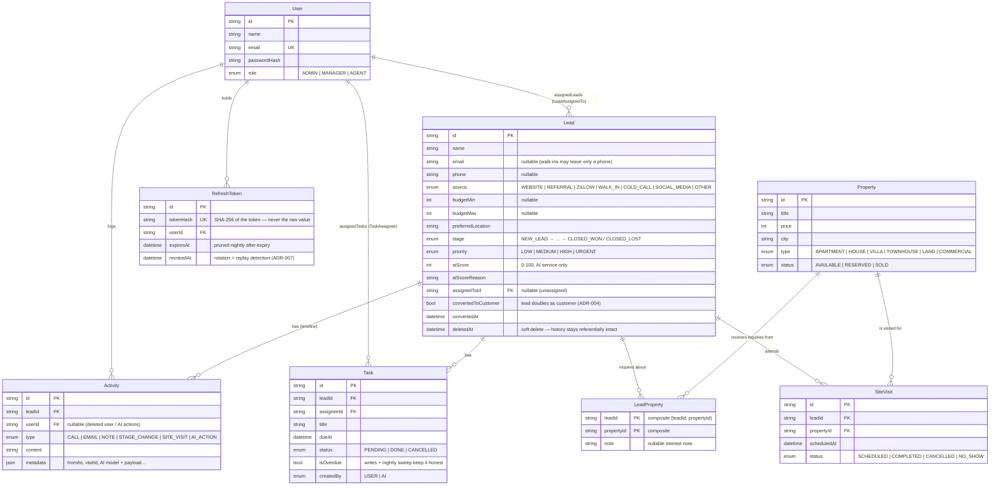
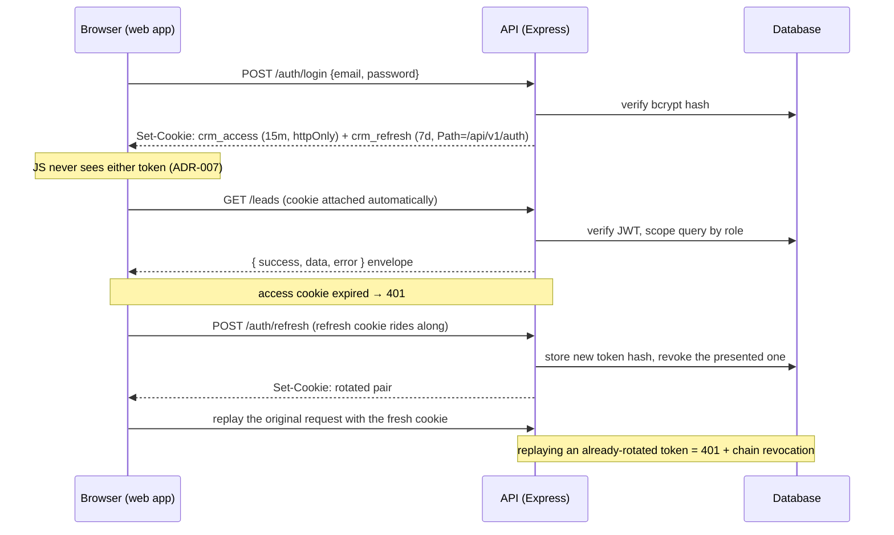
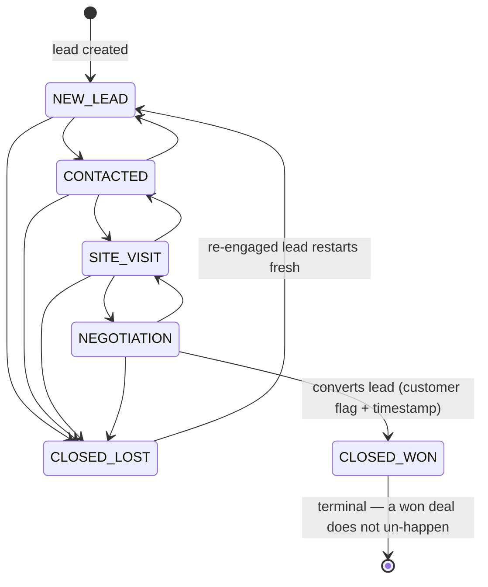

# Diagrams — data model and key flows

Mermaid renders these inline on GitHub and in most editors.

## Entity-relationship diagram

Mirrors `apps/api/prisma/schema.prisma` (Phase 1; rationale in
[ADR-004](DECISIONS.md) and [ADR-006](DECISIONS.md)). Only key columns shown.



## Authentication flow (httpOnly cookies + rotating refresh)



## Pipeline stage machine (ADR-009)

The API owns this table; `GET /leads/:id` returns the legal next moves as
`allowedTransitions` so the UI renders exactly the valid buttons and never
re-implements the rules.



Forward moves may skip stages; same-stage moves and illegal jumps answer 409
with the allowed targets in the error message.

## AI request flow (ADR-011)

```mermaid
sequenceDiagram
    participant U as Lead detail (AI assist)
    participant A as API (ai.service)
    participant P as Provider (any OpenAI-compatible endpoint)
    participant D as Database

    U->>A: POST /leads/:id/ai/score {note?}
    A->>A: findAccessibleLead (out-of-scope id → 404, before any AI check)
    A->>P: POST {AI_BASE_URL}/chat/completions (strict json_schema)
    P-->>A: JSON answer
    A->>A: zod-validate (invalid → 502, never a wrong score)
    A->>D: persist aiScore/aiReason + AI_ACTION activity
    A-->>U: { success: { score, reason, model, scoredAt } }
    Note over U: no AI_API_KEY configured → 503 with a "set AI_API_KEY" message;<br/>timeout → 504; every answer (success or failure) is auditable
```

## Request lifecycle (web → API)

```mermaid
flowchart LR
    R[Request] --> P{proxy.ts:<br/>crm_access cookie present?}
    P -- no --> L[/login]
    P -- yes --> S[Shell + page<br/>typed api client]
    S -->|fetch credentials: include| M{Express middleware}
    M --> G[rate limit → auth → validate]
    G --> C[controller → service]
    C --> DB[(Postgres via Prisma)]
    C --> E["{ success, data, error } envelope"]
    E --> S
    style L fill:#fee
    style E fill:#eef
```

Every layer validates: zod at the route boundary, the service re-checks
authorization (`findAccessibleLead`, `requireRole`), and the error handler is
the single place that turns failures into the envelope.
